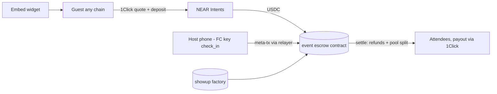

# ShowUp: any-chain event deposits (Kickback x Universal checkout)
Inspired by @ilblackdragon's "Event registration where funds get escrowed..." and "Universal checkout widget" ideas (https://x.com/ilblackdragon/status/2106269343881519444). Cancellation-window idea: https://x.com/0xspiked/status/2106815043446985136. Similar checkout product already live: https://x.com/alokyranjan/status/2108142222411809091.
Tracks: realworld, social, open.

## Problem
- Free crypto side events get about 50% no-shows.
- Deposits need the right token on the right chain, so most guests can't pay.

## User flow
1. Host creates an event: deposit $X in USDC, capacity, cancellation deadline, check-in window. The factory creates `<event>.showup.near`.
2. Guest clicks the embeddable "RSVP" button and pays from any chain and token via 1Click. The deposit settles as USDC to the event account, and the escrow contract records `rsvp(guest)`. Guests can deposit from any wallet through Aurora Intents Connect, or to a QR deposit address.
3. Guest cancels before the deadline → full refund. After the deadline the deposit is locked.
4. At the door: the host's phone holds a function-call key limited to `check_in`. It scans the guest's QR (a signed ticket), and the check-in is gasless via meta transaction.
5. After the event: `settle()` gives every attendee their deposit plus an equal share of the no-show pool. Payout goes to NEAR or to any chain via 1Click withdrawal.
6. Optional: AI concierge on NEAR AI Cloud answers guest questions privately, and the host's attendee list stays private (stretch).

## Architecture

## NEAR components
- Escrow plus factory contracts (Rust).
- NEAR Intents 1Click (any input → USDC; withdrawals).
- Function-call keys.
- Meta transactions (NEP-366) with a relayer.
- Named accounts.
- Optional Aurora Intents Connect.
- Optional NEAR AI concierge.

## MVP vs stretch
**MVP:**
- Testnet escrow with NEAR/USDC deposits, cancellation, check-in, settle.
- Widget.
- Host dashboard.
- A mainnet 1Click demo deposit from one EVM chain.

**Stretch:**
- Payout to any chain.
- Luma import.
- AI concierge.
- Private guest list.

## Day-by-day (UTC)
- **Nov 1:** Repo, contract design, tests.
- **Nov 2:** Escrow and settle math with property tests.
- **Nov 3:** Factory, testnet deploy.
- **Nov 4:** 1Click quote and status integration.
- **Nov 5:** Widget.
- **Nov 6:** Host dashboard.
- **Nov 7:** QR tickets and FC key check-in.
- **Nov 8:** Relayer meta transactions.
- **Nov 9:** Mainnet small-value end-to-end.
- **Nov 10:** Payout via 1Click.
- **Nov 11:** Dry-run event with friends.
- **Nov 12:** README.
- **Nov 13:** Video.
- **Nov 14:** Freeze.

## Demo script (60 s)
1. "Half your RSVPs never show. Now they pay the ones who do."
2. A guest pays from Base USDC in one click.
3. One guest cancels in time and is refunded.
4. Door scan: check-in.
5. Settle: the 3 attendees split 2 no-shows' deposits, shown on NearBlocks.
6. "Built at NEAR HACKATHON."

## README outline for the AI judges
- What, problem, architecture, NEAR tech.
- Run: `pnpm i; pnpm test` (sandbox), `pnpm demo:testnet`.
- Judge steps:
  - (1) Run `pnpm test` → see the settle tests pass.
  - (2) Run `pnpm demo:sim` → see a simulated event with 5 RSVPs, 3 check-ins and the payout table.
  - (3) Open the testnet explorer links.
- Mainnet proof transaction links.

## Risks and fallbacks
- 1Click is mainnet only (U) → the testnet escrow is fed NEAR directly; 1Click shown on mainnet with small funds.
- Lowest wow factor → polish the real event use, and run an actual side event.
- Host collusion (fake check-ins) → document it; stretch: attendee co-sign.
